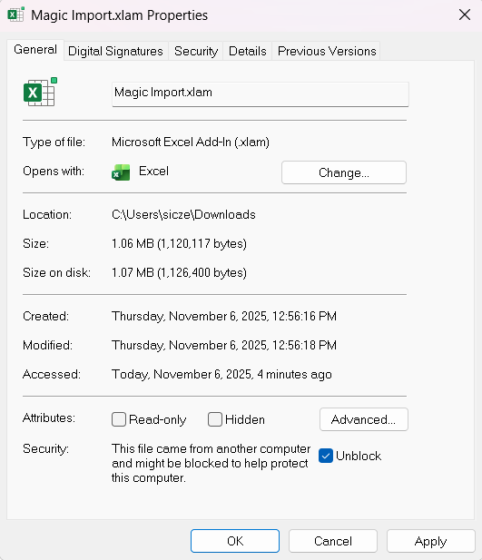
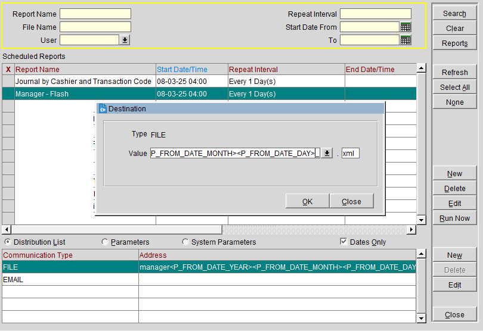
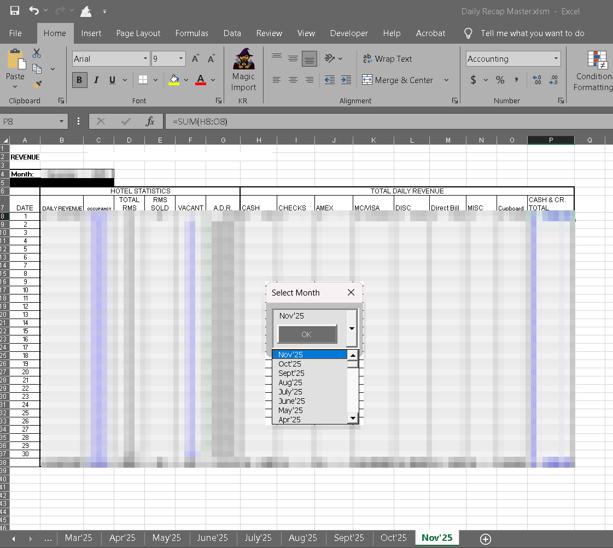

# MAGIC IMPORT

VBA macro for an OPERA PMS daily revenue recap spreadsheet. It imports the Manager Flash and Journal by
Cashier & Transaction Code reports (scheduled .xml exports) into the right day's row: it reads the date from
the report file name, then fills room revenue, rooms occupied and each payment type by transaction code
(MC and Visa are summed into one column). Bulk mode imports a whole month of report pairs at once and skips
days that already have data.

Getting the reports out of email first? See [`grabber/`](grabber/): a Google Apps Script that collects a
month of these reports from a Gmail label into one zip, privately, and lists any missing days.

The transaction codes and columns in `ParseAndWriteJournal` match one property's setup. Check them against
your own transaction codes and recap layout before using it.

---

## Install

1. Import `OperaImport_BulkReady.bas` into your recap workbook (saved as `.xlsm`): Developer > Visual Basic >
   File > Import File. The month picker uses a small UserForm named `Select_Month` with a `ComboBox1`,
   a `chkBulk` check box and an OK button.
2. Keep the workbook in one folder and add only that folder as a Trusted Location:
   File > Options > Trust Center > Trust Center Settings > Trusted Locations > Add new location.
   Macros in that folder run; everything else on your PC stays protected.
3. If Windows blocked a downloaded file, right-click it > Properties > General > check **Unblock**.



You do **not** need to choose "Enable all macros", turn off Protected View, or trust access to the VBA
project object model. Leave those settings at their defaults.

---

## Naming format for Reports Scheduler

**Manager Flash:**
```
manager<P_FROM_DATE_YEAR><P_FROM_DATE_MONTH><P_FROM_DATE_DAY>_
```

**Journal by Cashier & Transaction Code:**
```
journal<P_FROM_DATE_YEAR><P_FROM_DATE_MONTH><P_FROM_DATE_DAY>_
```

Both end with ".xml", which OPERA adds outside the custom name field. The underscore before ".xml" separates
the 8-digit date from the random number OPERA appends, so the macro can read the date and find the row.



## Recap spreadsheet format

One sheet per month, day numbers in column A. Figures below are blurred.


<br>
*Bulk Import: check "Bulk Import" before clicking OK in the month picker.
